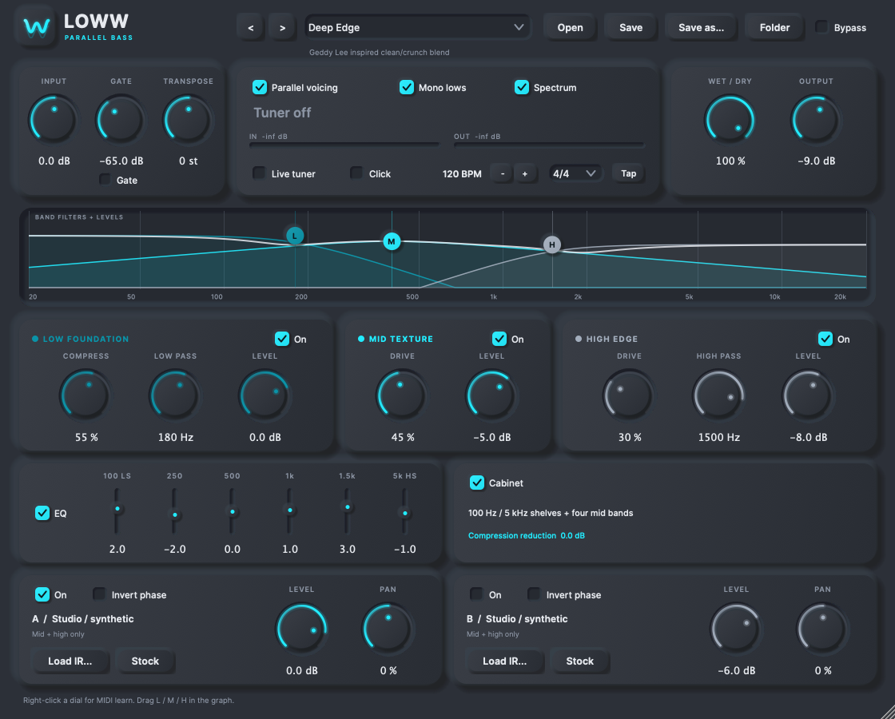

<p align="center">
  
</p>

<h1 align="center">LOWW</h1>

<p align="center">
  <strong>Shape your bass from low foundation to high edge.</strong><br>
  A native bass processor for macOS, available as a standalone app, VST3, and Audio Unit.
</p>

<p align="center">
  <a href="#get-started">Get started</a> ·
  <a href="#build-from-source">Build</a> ·
  <a href="#development">Develop</a> ·
  <a href="docs/user-guide.md">User guide</a>
</p>



## What it does

LOWW combines a compressed low band with independent mid and high saturation, giving you control over weight, texture, and attack in one interface. Built with C++20 and JUCE, it runs on its own or inside a DAW.

- **Three-band processing** with parallel voicing and an alternative Linkwitz–Riley crossover mode.
- **An interactive frequency graph** with draggable band controls and a live spectrum.
- **Two cabinet IR slots** with level, pan, polarity, and portable impulse-response storage.
- **Tone shaping** with a gate, six-band EQ, wet/dry blend, and optional mono lows.
- **Practice tools** including a ±12-semitone transpose, live tuner, and standalone metronome.
- **11 original factory tones**, user presets, and MIDI CC learn.

See the [user guide](docs/user-guide.md) for controls, signal flow, preset handling, and processing details.

## Get started

### Use a prebuilt app or plugin

The repository includes [Apple Silicon packages](dist/) and unpacked bundles in [`dist/macOS/`](dist/macOS/). The builds are ad-hoc signed and are not notarized. macOS may require approval before opening them.

| Format | Location | Use |
| --- | --- | --- |
| Standalone | `dist/macOS/LOWW.app` | Play through an audio interface without a DAW |
| VST3 | `dist/macOS/LOWW.vst3` | Load LOWW as an effect in a VST3 host |
| Audio Unit | `dist/macOS/LOWW.component` | Load LOWW as an effect in an AU host |

For a per-user plugin installation, copy the VST3 bundle to `~/Library/Audio/Plug-Ins/VST3/` or the AU bundle to `~/Library/Audio/Plug-Ins/Components/`, creating the folder if needed. Rescan plugins or restart your DAW afterward.

### Play your first note

1. Open **LOWW.app**.
2. Open **Audio settings...** and select your audio interface, physical input, output, and buffer size.
3. Use **Mono** for one instrument input or **Stereo** for two inputs.
4. Enable **Monitor input** and choose a factory tone.

Use headphones when monitoring to avoid speaker feedback. The standalone app starts with audio disconnected; select your device and preset each session. Plugins use the DAW's audio routing.

User presets live in `~/Documents/LOWW Presets/`. Imported cabinet IRs are embedded when you save a preset. Factory tone changes preserve your cabinet settings.

## Build from source

### Requirements

- macOS with the Xcode Command Line Tools and a C++20 compiler.
- CMake **3.24 or newer**, Ninja, and Git.
- Internet access for the first configure, which fetches JUCE and Signalsmith Linear.

Install Apple's tools with `xcode-select --install`. If you use Homebrew, install the build tools with `brew install cmake ninja`.

The packaged binaries target Apple Silicon. The project sets a minimum macOS deployment target of 11.0; Windows and Linux builds have not been verified.

### Configure and compile

```sh
git clone https://github.com/qeireal/LOWW.git
cd LOWW

cmake -S . -B build -G Ninja -DCMAKE_BUILD_TYPE=Release
cmake --build build --parallel
```

This builds the standalone app, VST3, Audio Unit, and test executable. Build products stay in `build/`; CMake does not install plugins or update the packaged files in `dist/`.

| Output | Path |
| --- | --- |
| Standalone app | `build/LOWW_artefacts/Release/Standalone/LOWW.app` |
| VST3 plugin | `build/LOWW_artefacts/Release/VST3/LOWW.vst3` |
| Audio Unit | `build/LOWW_artefacts/Release/AU/LOWW.component` |
| Test executable | `build/LOWWTests` |

Run the app:

```sh
open build/LOWW_artefacts/Release/Standalone/LOWW.app
```

<details>
<summary>Build options</summary>

Use a local JUCE checkout instead of fetching the pinned revision:

```sh
cmake -S . -B build -G Ninja -DCMAKE_BUILD_TYPE=Release \
  -DJUCE_SOURCE_DIR=/absolute/path/to/JUCE
```

Build for both Apple Silicon and Intel Macs in a separate directory:

```sh
cmake -S . -B build/universal -G Ninja -DCMAKE_BUILD_TYPE=Release \
  -DCMAKE_OSX_ARCHITECTURES="arm64;x86_64"
cmake --build build/universal --parallel
```

The universal configuration is available through CMake; the included packages and recorded validation cover Apple Silicon.

To omit the test executable, add `-DLOWW_BUILD_TESTS=OFF` when configuring. Use a separate build directory when changing CMake generators.

</details>

## Development

### Set up a debug build

Keep development builds separate from the release output:

```sh
cmake -S . -B build/debug -G Ninja \
  -DCMAKE_BUILD_TYPE=Debug \
  -DCMAKE_EXPORT_COMPILE_COMMANDS=ON
cmake --build build/debug --parallel
open build/debug/LOWW_artefacts/Debug/Standalone/LOWW.app
```

Open the repository in a C++ editor with CMake support. Point clangd or your editor's C++ tooling at `build/debug/compile_commands.json` for code navigation and completion.

After editing, rebuild with `cmake --build build/debug --parallel`. To build only the standalone app, add `--target LOWW_Standalone`. Quit and reopen the app to load the new executable; save your tone before restarting. You can attach a debugger to LOWW or launch `build/debug/LOWW_artefacts/Debug/Standalone/LOWW.app/Contents/MacOS/LOWW` directly under LLDB.

### Find the code

| Area | Files | Responsibility |
| --- | --- | --- |
| Audio engine | [`Source/Engine.cpp`](Source/Engine.cpp), [`Source/Engine.h`](Source/Engine.h) | Band processing, oversampling, transpose, convolution, EQ, smoothing |
| Plugin processor | [`Source/Processor.cpp`](Source/Processor.cpp), [`Source/Processor.h`](Source/Processor.h) | Parameters, state, presets, IR loading, MIDI, metronome |
| Interface | [`Source/Editor.cpp`](Source/Editor.cpp), [`Source/Editor.h`](Source/Editor.h) | Controls, spectrum, graph interaction, scalable layout |
| Tuner | [`Source/Tuner.h`](Source/Tuner.h) | Input pitch detection |
| Standalone host | [`Source/Standalone.cpp`](Source/Standalone.cpp), [`Source/InstrumentPlayer.h`](Source/InstrumentPlayer.h) | Device setup, MIDI input, mono/stereo monitoring |
| Tests | [`Tests/AudioTests.cpp`](Tests/AudioTests.cpp), [`Tests/MonitoringTests.h`](Tests/MonitoringTests.h) | DSP, state, monitoring, plugin-host checks |

### Run the checks

Build all targets before running CTest, because the host checks load the compiled plugin bundles:

```sh
cmake --build build/debug --parallel
ctest --test-dir build/debug -C Debug --output-on-failure
```

For a release build, use `ctest --test-dir build -C Release --output-on-failure`.

The four macOS checks cover audio processing and state, instrument monitoring, VST3 hosting, and AU hosting. The AU check needs access to macOS Audio Component services. [`VALIDATION.txt`](VALIDATION.txt) records an earlier successful run; physical MIDI hardware and third-party DAW sessions remain unverified.

### Generate development assets

The test executable also exports presets, interface screenshots, synthetic audio demos, and the app icon. These examples use the debug build and write into the ignored `build/` directory:

```sh
build/debug/LOWWTests --snapshot "$PWD/build/editor.png" 1120 900
build/debug/LOWWTests --export-presets "$PWD/build/presets"
build/debug/LOWWTests --demo "$PWD/build/demo"
build/debug/LOWWTests --logo "$PWD/build/Icon.png" 1024
```

## Documentation and support

- [User guide](docs/user-guide.md): processing modes, controls, cabinet slots, and presets.
- [Preset research](docs/artist-rig-research.md): inspiration, sources, and tone recipes.
- [Recorded validation](VALIDATION.txt): results from the existing regression suite.
- [Synthetic audio examples](demo/): dry and processed bass demos.

Report bugs or suggest improvements through [GitHub Issues](https://github.com/qeireal/LOWW/issues). Include your macOS version, CPU architecture, app or plugin format, host version, and steps to reproduce. For code contributions, describe the behavior you changed and the checks you ran.

## Dependencies and credits

| Dependency | Revision | License information |
| --- | --- | --- |
| JUCE | 8.0.12, pinned to `29396c22c93392d6738e021b83196283d6e4d850` | [Bundled license](dist/licenses/JUCE-LICENSE.md) |
| Signalsmith Stretch | Vendored at `a670068d9aeb64913331d5cc29337b19a457a7df` | [MIT license](third_party/signalsmith-stretch/LICENSE.txt) |
| Signalsmith Linear | 0.6.4, fetched by CMake | [MIT license](dist/licenses/Signalsmith-Linear-MIT.txt) |
| Open Runde | Embedded interface typeface by Laurids Kern | [SIL Open Font License 1.1](Resources/Fonts/OFL.txt) |

Factory tones are original, unendorsed starting points. The stock cabinet response is synthetic; the project includes no commercial cabinet IRs. See the [user guide](docs/user-guide.md) for the scope and limitations of the audio models.
